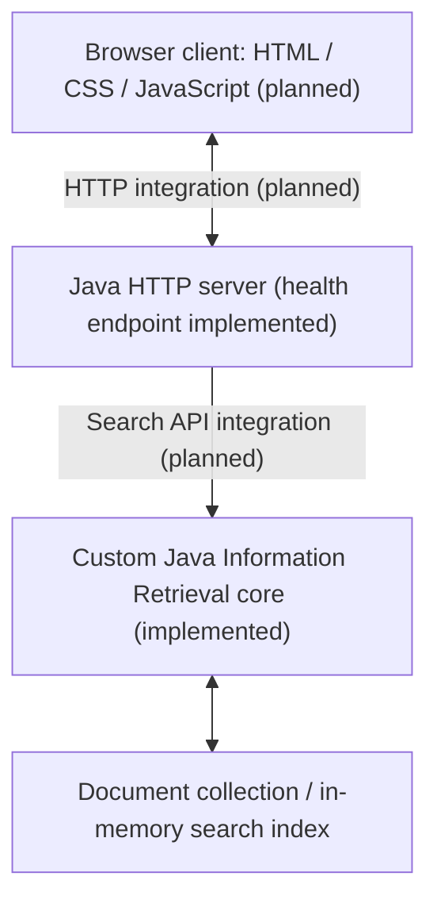

# IIT Search Engine

**SPL-1 Project**

Institute of Information Technology, University of Dhaka

**Student:** Rifat Al Maruf (BSSE1705)

## Overview

IIT Search Engine is a Java-based, domain-specific document search engine using
classical Information Retrieval (IR). Its academic objective is to implement
and understand preprocessing, indexing, matching, ranking, and result retrieval
over public or supervisor-authorized IIT documents.

The current Version 0.1 CLI searches six fictional demonstration text files.
Phase 2.1 adds an independent HTTP health server on the
`feat/http-health-endpoint` branch. Development is ongoing.

## Required client-server architecture

The supervisor requires a Java HTTP server and a browser client built with
HTML, CSS, and JavaScript. The intended architecture is:



The CLI already calls the IR core directly. The HTTP server currently serves
only `/health`; it does not call `SearchEngine`. The browser interface, HTTP
search API, and cross-computer demonstration are upcoming milestones.

## Current implementation

- UTF-8 loading of immediate `.txt` files, sorted by filename.
- Case normalization, ASCII letter/digit tokenization, punctuation separation,
  and filtering of 12 configured stop words.
- An inverted index mapping each term to document IDs and raw occurrence counts.
- Exact normalized keyword lookup and multi-word retrieval with ranked OR
  semantics; repeated query terms are counted once.
- TF-IDF-style ranking using
  `idf = ln((N + 1) / (df + 1)) + 1`, multiplied by raw term frequency and summed
  over distinct query terms. There is no document-length normalization.
- Descending score ordering with filename order for ties; all matches returned.
- A CLI menu for full index rebuild, search, statistics, and exit. A failed
  rebuild preserves the previously built index.
- A JDK HTTP server at `127.0.0.1:8080`: exact `GET /health` returns HTTP 200,
  `Content-Type: text/plain; charset=utf-8`, and the two-byte body `OK`.
  Unsupported methods on that path return 405 with `Allow: GET`; other paths
  return 404.
- Seven dependency-free automated baseline regression tests for the IR core.

Verified sample-corpus statistics are **6 documents, 75 unique terms, and 120
processed tokens**. Searching `java` returned `java_programming.txt` (displayed
score 5.54), followed by `academic_notice.txt` (1.85).

Boolean operators are not parsed: `and` and `or` are currently stop words.
Quoted text is treated as ordinary keywords rather than a phrase query.

## Roadmap

1. HTTP search API connected to the existing `SearchEngine`, request validation,
   and JSON result responses.
2. Browser client, client-server integration, and a verified cross-computer
   network demonstration.
3. Positional indexing, explicit Boolean AND/OR queries, and phrase retrieval.
4. Partial/substring matching, basic fuzzy retrieval, Top-K results, and snippets.
5. Index persistence, further search improvements, and performance evaluation
   against a sequential-scan baseline.
6. Authorized IIT PDF import and text extraction, with OCR scope to be agreed
   with the supervisor.

These are planned capabilities. PDF extraction, fuzzy matching, positional
postings, snippets, persistence, and performance benchmarks are not implemented.

## Technology and academic scope

- Java; verified with Eclipse Temurin **JDK 25.0.3**.
- Built-in Java `HttpServer` from `jdk.httpserver`.
- HTML, CSS, and JavaScript for the planned browser client.
- IntelliJ IDEA, Git, and GitHub.

Core IR algorithms and data structures are implemented manually to make their
behavior explainable and evaluable for SPL-1. No Lucene, Elasticsearch, Solr,
or other ready-made search-engine core is used. There are no external Java
dependencies, Maven/Gradle configuration, or JUnit dependency in the current
prototype.

## Repository structure

```text
src/
  Document.java          Document ID and filename
  TextProcessor.java     Token normalization and stop-word filtering
  InvertedIndex.java     Term-to-document frequency postings
  SearchEngine.java      Loading, indexing, retrieval, and ranking
  SearchResult.java      Document and score
  Main.java              Original CLI entry point
  SearchServer.java      Independent HTTP health-server entry point
tests/
  BaselineTests.java     Seven automated regression tests
data/                    Six fictional demonstration text documents
documents/               Original proposal form and presentation
learnings/               Learning journal and viva preparation
out/                     Ignored generated classes and local verification output
iit-search-engine-prototype-v0.1.zip   Archived prototype
README.md
```

## Build, run, and test

Use PowerShell from the repository root. The commands below use one explicit
JDK for compilation and execution, avoiding the previously observed Java 8
launcher on `PATH`. Change the JDK path if your installation differs. This
project's verified toolchain is JDK 25; no dependency installation is needed.

```powershell
Set-Location 'D:\iit_drive\IIT\spl1\iit-search-engine'
$projectJdk = 'C:\Program Files\Eclipse Adoptium\jdk-25.0.3.9-hotspot'
& "$projectJdk\bin\javac.exe" -version
& "$projectJdk\bin\java.exe" -version
& "$projectJdk\bin\javac.exe" -encoding UTF-8 -d out\app src\*.java tests\BaselineTests.java
```

Compile successfully before running the following commands. Classes are written
only to ignored `out/app`; the existing source and sample documents are unchanged.

### CLI

```powershell
& "$projectJdk\bin\java.exe" -cp out\app Main
```

The CLI builds from relative folder `data`, so keep the repository root as the
working directory. Choose `3` for statistics, `2` then `java` for a sample search,
and `4` to exit.

### Regression tests

```powershell
& "$projectJdk\bin\java.exe" -cp out\app BaselineTests
```

The runner reports seven individual results and totals. Expected baseline:
`Total passed: 7`, `Total failed: 0`, exit code 0. Checks use explicit
`AssertionError`s, so `-ea` is unnecessary. Temporary fixtures are separate from
`data` and cleaned up by the harness.

### HTTP health server

When port 8080 is available, start the server in its own console:

```powershell
& "$projectJdk\bin\java.exe" -cp out\app SearchServer
```

Expected startup message: `Listening on http://127.0.0.1:8080`.
From a second PowerShell console, use Windows `curl.exe`:

```powershell
curl.exe --noproxy '*' -i http://127.0.0.1:8080/health
```

Expected response: HTTP 200, `Content-Type: text/plain; charset=utf-8`, and body
`OK` without a newline. Use Ctrl+C in the server's own console to stop the
instance you launched. If startup reports `Address already in use`, do not
terminate an unidentified process to free the port.

### Verification record

The JDK 25.0.3 compilation command, CLI smoke test, and seven regression tests
passed during the October 26, 2026 workflow. The HTTP results above were
successfully verified earlier in Task 2.1, including 404 for unknown/suffixed
paths and 405 with `Allow: GET` for POST `/health`.

A later HTTP rerun could not start because port 8080 was occupied. No fresh HTTP
run is claimed for these documentation changes. The curl command is a manual
checking instruction; the recorded automated HTTP checks used a .NET HTTP client.
The source has not changed since the successful HTTP verification. Neither a
browser client nor cross-computer connectivity has been verified.

## Development progress and learning journal

- **Phase 1 complete:** architectural audit, JDK compilation, CLI smoke testing,
  and seven baseline regression tests.
- **Phase 2.1 complete:** minimal HTTP health endpoint implemented, reviewed,
  tested, and published on the feature branch.
- **Task 2.2 has not started:** search API and browser integration remain planned.

See the [learning journal](learnings/README.md),
[Phase 1 foundations](learnings/01-phase1-foundations.md), and
[HTTP/client-server foundation](learnings/02-01-http-health-endpoint.md).

## Current limitations

The bundled sample data is **fictional demonstration content, not official IIT
documentation**. The current index is in memory, supports English ASCII tokens,
and loads text files only. Document IDs depend on sorted filenames. The HTTP
server binds only to loopback and exposes no search functionality. This is an
academic system under active development; broader retrieval quality,
performance, and network behavior remain to be evaluated.
