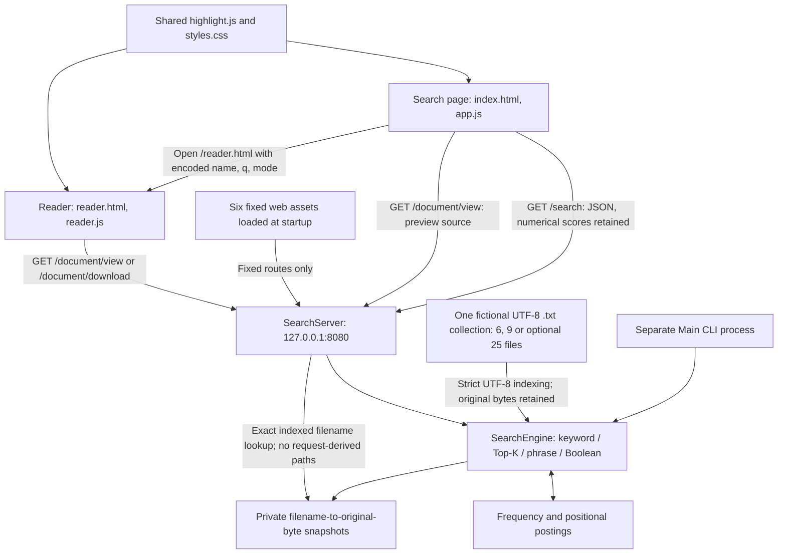

# IIT Search Engine

**SPL-1 Project**

Institute of Information Technology, University of Dhaka

**Student:** Rifat Al Maruf (BSSE1705)

## Overview

IIT Search Engine is an SPL-1 project for finding documents in an IIT-focused
collection without opening each file manually. It uses classical Information
Retrieval (IR), with custom Java code for preprocessing, indexing, matching,
and ranking. The aim is to understand these algorithms and eventually apply
them to public or supervisor-authorized IIT documents.

The current browser and HTTP JSON API support ranked keyword search with optional
optimized Top-K selection, exact phrase retrieval, and explicit Boolean AND/OR
retrieval. Startup selects six original fictional files, a separate nine-document
phrase collection, or an optional 25-document fictional showcase. A separate CLI retains its
original keyword-search menu.
The browser uses plain HTML, JavaScript and CSS for query composition and
presentation; Java owns indexing, authoritative HTTP query validation, retrieval
and keyword ranking.

## Midterm demonstration

Phases through **3.5C are implemented and fast-forward integrated**. The frozen
application checkpoint, including Premium Midnight Scholar and the optional showcase, is
`28a26ab986351b5d99d29aba26e873e30793c931`. The six-file Phase 3.5D Part 1
documentation was reviewed and integrated at `cdc3b504f231d9fc961648970318f103c6543b59`.
Presentation/rehearsal/viva preparation is still pending; integration did not
complete those activities. No retrieval changes or UI redesign are part of the
November 10 final audit. The showcase was independently source-reviewed on GitHub
and fast-forward integrated into local main. It remains optional and isolated
from the unchanged six/nine-file standard demo before the **November 12, 2026** examination.

Fresh Codex-run original regression on November 10 passed **562 checks, 0 failed**,
both before and after the showcase change: 100 Java, 320 HTTP, 107 browser-model
and 35 highlighting/reader checks. The showcase adds 18 Java and 70 HTTP checks,
reported separately: **650 passed, 0 failed overall**. One
Windows symlink fixture was skipped because creation requires an unavailable
privilege. See the [verification record](#testing-and-verification-record).
The earlier Phase 3.5D total of 547 and Phase 3.4 total of 287 remain historical evidence.

The student explicitly reported successful **manual Microsoft Edge verification**
of Basic Keyword Search/Top-K, exact phrases, grouped Advanced Search, document
opening/downloading, snippets, keyword/phrase/Boolean highlights, the highlighted
reader and raw-text access, on both collections. Codex did not independently
perform those student-reported browser checks. Premium UI and adaptive Advanced
Search acceptance was also explicitly student-reported. This report does not establish a comprehensive
keyboard, screen-reader, zoom/reflow or browser/device matrix audit.

On **November 10, 2026**, the student also confirmed all six showcase Edge
scenarios: java (23 results), java search Top 3, both phrase orders, the mixed
AND/OR query (four results), and reader/highlighting/original download. These
are student-reported manual checks, not independently automated browser tests.

Use the [midterm demo runbook](docs/MIDTERM_DEMO_RUNBOOK_2026-11.md) for Windows
commands and source-checked query/results. Fourteen historical learning manuals
are preserved, with one new [consolidated Phase 3.5 manual](learnings/03-08-phase-35-midterm-features.md)
integrated at `cdc3b50`. November 10 is for slides/speech; November 11 is for
rehearsal, code explanation and viva preparation. Those tasks are still pending.

## Midterm Supervisor Feedback and Phase 3.5 Plan

According to the student's November 2026 report of the supervisor meeting, the
classical IR algorithms already covered the midterm algorithm scope. Practical
usability became the priority. This is a paraphrased student report, not a
meeting quotation or blanket approval of future work; no meeting date is invented.
The original planning baseline was `bfb28f676a73443a9cc383cb9ccad52b415b94c8`.

The [supervisor plan](docs/MIDTERM_SUPERVISOR_PLAN_2026-11.md) now records:

| Phase | Current status |
| --- | --- |
| 3.5R | Planning checkpoint integrated at `13ea98f` |
| 3.5A | Advanced Search and browser score hiding integrated at `35482fa` |
| 3.5B | Indexed text viewing/downloading integrated at `e1f433c` |
| 3.5C | Snippets and safe reader highlighting integrated at `ab6eacc` |
| 3.5D | Part 1 documentation integrated (`cdc3b50`); presentation, rehearsal and viva preparation remain open |
| Premium UI | Midnight Scholar and adaptive word layout integrated (`143ab55`); retrieval unchanged |

Basic Keyword Search remains OR-like ranked retrieval: any searchable query term
may make a document eligible. It is not strict AND or identical to unranked
Boolean OR. Advanced Search composes AND words within OR groups and keeps
`mode=boolean`. For `computer AND (java OR python)`, repeat the shared condition:
`computer AND java OR computer AND python`. The shortened
`computer AND java OR python` has different meaning. Parentheses here explain
intent; the parser does not accept them. IEEE Xplore inspired the group layout,
without metadata fields or an additional retrieval algorithm.

Scores remain in Java and keyword JSON; only their browser display is hidden.
Fuzzy/semantic search, PDF, images/OCR, Bangla processing, metadata/date filtering
and deployment remain deferred proposals requiring further agreement. Real IIT
use would still require document rights, authorization, security and hosting
decisions. The historical [November 1 supervisor agenda](PLANNED_FEATURES.md#questions-for-the-supervisor-november-1-2026)
is retained separately.

## Current architecture

Java owns retrieval. The browser composes queries and presents JSON results,
then fetches original indexed text for previews and the highlighted reader.



`Main` and `SearchServer` are separate entry points with separate engines. The
CLI supports manual rebuilds; the HTTP server builds once before listening.
A successful build replaces its structures after all reads succeed; failed
builds preserve the prior index and bytes. This is failed-build preservation,
not a guarantee of atomic publication to concurrent rebuild/search threads.

The server selects one collection and reads six trusted fixed web assets at
startup. Restart it after intended collection or web-file changes. Document
requests read snapshots rather than reopening filenames from the browser;
source changes/deletions do not alter served bytes until a successful rebuild
or restart. No HTTP rebuild endpoint exists. This small in-memory prototype is
not a production authorization or general-purpose file server.

## Current implementation

- Strict UTF-8 loading of immediate `.txt` files, sorted by filename; original
  byte snapshots with exact filename lookup and defensive copies. Symlink entries
  are rejected and file opens use NOFOLLOW_LINKS; the Windows symlink fixture
  remains skipped, so comprehensive filesystem security is not claimed.
- Shared lowercase ASCII letter/digit tokenization with punctuation as separators.
  Keyword processing filters 12 configured stop words; complete tokenization
  retains them for positions and phrase retrieval.
- Frequency postings map searchable terms to document IDs and raw occurrence
  counts. Positional postings additionally store all zero-based token positions,
  including stop words, gaps and repeated occurrences. Read-only positional
  snapshots preserve index encapsulation.
- Exact normalized keyword lookup and multi-word retrieval with ranked OR
  semantics; repeated query terms are counted once.
- TF-IDF-style ranking using
  `idf = ln((N + 1) / (df + 1)) + 1`, multiplied by raw term frequency and summed
  over distinct query terms. There is no document-length normalization.
- Descending score ordering with filename order for ties. Unrestricted keyword
  search returns all matches using the existing manual stable insertion sort.
- `searchTopK(query, k)` uses posting-driven sparse scoring and a manually
  implemented bounded binary heap. It retains at most K matches without sorting
  all matches or delegating to full search. Scores, query-term accumulation order
  and filename tie-breaking preserve the exact prefix of unrestricted search.
  Candidate relevance scores still have to be calculated.
- Exact normalized phrase retrieval using positional alignment in the same
  document, retaining stop words and repeated terms.
- Explicit Boolean AND/OR retrieval using frequency-posting document-ID sets.
  Operators ignore case and AND takes precedence over OR. Stop-word operands,
  missing operators/operands, parentheses, NOT, quoted operands and wildcards
  are rejected with descriptive errors.
- Phrase and Boolean results contain each matching document once in filename
  order, without ranking scores. Retrieval uses the index without rescanning files.
- A CLI menu for full index rebuild, search, statistics, and exit. A failed
  rebuild preserves the previously built index.
- A JDK HTTP server at `127.0.0.1:8080`: exact `GET /health` returns HTTP 200,
  `Content-Type: text/plain; charset=utf-8`, and the two-byte body `OK`.
- Exact `GET /search?q=...&mode=...` selects keyword, phrase or Boolean retrieval.
  Missing mode or mode=keyword preserves the original query/results JSON with
  numeric scores. Phrase/Boolean JSON includes mode and filename-only results.
- Optional `k` in keyword mode dispatches directly to `searchTopK()` and uses the
  same keyword JSON serializer, scores and field ordering. Without `k`, retrieval
  remains unrestricted; no server-selected default limit is imposed.
- Query parsing requires one nonblank `q`, splits parameters before decoding,
  handles percent escapes and `+` as space, and rejects duplicate `q`, malformed
  escapes, invalid UTF-8, and parameters without `name=value` syntax. An optional
  single mode must be exactly keyword, phrase or boolean; invalid/duplicate modes
  and malformed Boolean expressions return descriptive JSON HTTP 400.
- A supplied `k` must consist only of ASCII decimal digits and represent an int
  from 1 through 2147483647. Leading zeros are accepted. Empty/blank values,
  zero, signs, negatives, fractions, exponents, Unicode digits, overflow and
  duplicate `k` are rejected. Phrase and Boolean modes reject any supplied `k`.
- Application-handled query validation errors return HTTP 400 with a JSON
  `error` field. JSON strings escape quotes, backslashes, and low controls.
- Unsupported methods on any known path return 405 with `Allow: GET`;
  unknown paths return 404. Path validation precedes method validation.
- Six dependency-free Java suites (100 passes, one skipped fixture), HTTP suites
  on the original collections (320), and Node browser/presentation models (107 + 35).
  Dedicated showcase coverage adds 18 Java and 70 HTTP checks.
- An accessible native GET form with three labeled radio modes, keyword selected
  by default, Boolean help and a required query. Without JavaScript, it can
  navigate to the selected mode's raw JSON response.
- An accessible keyword result-limit select: All results (default), Top 1, Top 3,
  Top 5 and Top 10. JavaScript enables it only in keyword mode and adds `k` only
  for a selected limit. Mode changes preserve its value. The unnamed select
  starts disabled so JavaScript-free GET submission never sends `k`.
- Plain JavaScript submit handling with URLSearchParams, fetch, safe textContent
  rendering, loading feedback, and empty/error messages. Repeated completed
  searches replace earlier results; numerical scores are hidden in the browser.
  Mode/limit changes and query or builder edits abort obsolete search/preview
  fetches, invalidate their request ID, and clear results/status. ID guards prevent
  stale success/error/cleanup updates; rendering exceptions clear any partial results. The browser
  does not rank or truncate results. Limited status reports returned count and
  selected limit without claiming a total matching count.
- Advanced Search has labeled single-word inputs, AND words within OR groups,
  add/remove controls, validation and an exact expression preview. It retains
  the existing Boolean backend, at least one group/word, and native GET fallback.
- Premium Midnight Scholar styling uses local system fonts, native radio cards,
  result cards and a coherent reader. Advanced words wrap to at most three per
  wide row, two at intermediate container widths and one on narrow containers;
  flex growth fills incomplete rows. Values and Boolean order are independent
  of layout. Focus, compact accessible remove actions and reduced motion remain.
- Every result links to `/reader.html` with encoded filename/query/mode, and has
  a separate original Download action. New-tab links use noopener/noreferrer.
- `/document/view` returns indexed original bytes as UTF-8 plain text;
  `/document/download` adds a safe attachment filename. Both use nosniff. Only
  an exact selected-collection snapshot hit can return content.
- Context previews fetch that raw endpoint and select around a verified match.
  The shared manual ASCII scanner retains original character offsets; safe DOM
  text nodes and mark elements preserve source text rather than creating summaries.
  Keyword highlights exclude stop words, phrase highlights belong to complete
  normalized occurrences, and Boolean highlights belong to satisfied AND groups.
  The reader renders the whole document and also links to raw text and download.
- Local responsive CSS with system fonts, blue/neutral colors, visible keyboard
  focus, disabled-button styling, wrapping results, and stacked narrow-screen controls.

Previously verified sample-corpus statistics are **6 documents, 75 unique terms,
and 120 processed tokens**. Searching `java` ranks `java_programming.txt` before
`academic_notice.txt`. The CLI displays scores as 5.54 and 1.85; the JSON API
returns numeric values without that formatting. Browser results display no scores.

### Fixed demonstration collections

| Server startup | Indexed folder | Documents |
| --- | --- | --- |
| `SearchServer` | Immediate `.txt` files in `data/` | 6 original fictional documents |
| `SearchServer --phrase-demo` | `data/phrase_samples/` | 9 separate fictional IIT-themed samples |
| `SearchServer --showcase` | `data/showcase/` | 25 optional original fictional academic notes |

The loader is not recursive, so the nested samples never silently join the
default corpus. The [sample README](data/phrase_samples/README.md) describes the
nine-file collection. All three collections are fictional, not official IIT records.
Startup selects the corpus; the browser's radio control selects an algorithm
over that corpus, and its keyword selector optionally limits ranked results.
The server accepts no arbitrary document-path option.

The standard midterm route remains the original six/nine-file demonstration.
For optional variety, see the [showcase inventory, measured queries and commands](data/showcase/README.md).
It has 25 documents, 1,336 searchable terms and 3,808 processed tokens. Selection
is startup-only: stop your own server and restart without arguments to return
to the default. No HTTP/browser collection switch or new retrieval algorithm exists.

The three modes keep separate semantics. AND/OR are operators only in Boolean
mode. In keyword mode they remain filtered stop words, and quotes do not enable
phrase grammar. Select phrase mode and supply phrase text directly; quotes are
ordinary separators there. Phrase matching is exact after normalization, not
character-for-character punctuation or case matching.

## JSON Search API

### Search modes

| mode parameter | Behavior | Successful JSON |
| --- | --- | --- |
| Missing or `keyword` | Ranked keyword search; optional positive `k` selects optimized Top-K | query, results; each result has filename and numeric score |
| `phrase` | Exact normalized phrase | query, mode=phrase, results; each result has filename only |
| `boolean` | Explicit AND/OR expression | query, mode=boolean, results; each result has filename only |

Mode values are case-sensitive; Boolean operators inside q are case-insensitive.
All examples below use the default six-document startup unless stated otherwise.

### Successful keyword search

Request: `GET /search?q=java`

Status: **200**. Content-Type: `application/json; charset=utf-8`.
The following previously verified response is shown with indentation for
readability; the server emits compact JSON:

```json
{
  "query": "java",
  "results": [
    {
      "filename": "java_programming.txt",
      "score": 5.541893581161611
    },
    {
      "filename": "academic_notice.txt",
      "score": 1.8472978603872037
    }
  ]
}
```

`query` echoes the accepted decoded text. Results retain the engine's ranking
order, and `score` is a JSON number. There is no separate rank field.

### Optimized keyword Top-K

Request: `GET /search?q=java&mode=keyword&k=1`. Status: **200**, with the same
JSON Content-Type and keyword schema:

```json
{"query":"java","results":[{"filename":"java_programming.txt","score":5.541893581161611}]}
```

`GET /search?q=java&k=1` is equivalent. The server calls `searchTopK()` directly;
it does not call full search and truncate. The response contains the exact
ranking prefix and numeric scores, without extra mode/K/total-count fields.
If K exceeds the matching count, every match is returned. For example, `java`
with `k=10` returns the two results in the unrestricted example. Valid unknown
queries still return HTTP 200 with an empty results array.

K is keyword-only and must be a single ASCII-digit decimal value from 1 through
`Integer.MAX_VALUE` (2147483647); `003` is valid. There is no whitespace trimming
or support for signs, fractions, exponent/radix notation or Unicode digits.
Overflow and duplicates are errors. Maximum K is valid without proportional heap
preallocation. Missing K preserves full search, including its legacy JSON.

`GET /search?q=java&k=0` returns HTTP **400**:

```json
{"error":"Bad request: k must be a decimal integer from 1 to 2147483647."}
```

Supplying `k` with `mode=phrase` or `mode=boolean` returns HTTP **400** with
`Bad request: k is supported only in keyword mode.` Invalid requests do not
change the next request's limit or stop the server.

### Exact phrase and Boolean results

Request: `GET /search?q=computer%20networking&mode=phrase`. Status: **200**.

```json
{"query":"computer networking","mode":"phrase","results":[{"filename":"networking.txt"}]}
```

Request: `GET /search?q=java%20AND%20programming&mode=boolean`. Status: **200**.

```json
{"query":"java AND programming","mode":"boolean","results":[{"filename":"java_programming.txt"}]}
```

Both use the same JSON Content-Type and return filenames in filename order.
No score field is fabricated. On the demo collection, the same Boolean expression
instead matches java_programming_lab.txt and seminar_discussion.txt.

For Boolean precedence, `java OR networking AND laboratory` means java OR the
networking/laboratory intersection. It returns academic_notice.txt,
java_programming.txt, then networking.txt on the default corpus. Parentheses
may describe the meaning, but entering them is unsupported.

### No results

Request: `GET /search?q=zzzznomatchingterm`

Status: **200**, with the same JSON Content-Type. A valid query with no matching
documents returns an empty array:

```json
{"query":"zzzznomatchingterm","results":[]}
```

### Invalid query

Request: `GET /search` (missing query component)

Status: **400**, with the same JSON Content-Type:

```json
{"error":"Bad request: Missing q parameter."}
```

The prefix is exactly `Bad request: `. Blank values, duplicate q/mode/k parameters,
invalid modes/encodings/limits, and malformed Boolean expressions also produce handled
validation errors with a specific reason. For example, the request
`GET /search?q=java%20AND&mode=boolean` returns HTTP 400:

```json
{"error":"Bad request: Missing operand after AND."}
```

Valid unknown Boolean operands instead produce successful empty sets, not syntax
errors. Other well-formed parameters are decoded and ignored; parameter names
are case-sensitive. The API reads URL parameters and does not parse JSON request
bodies. A malformed request URI can be rejected by the HTTP stack before the
application's JSON error handler runs.

### Health and routing behavior

| Request | Status and response |
| --- | --- |
| `GET /` | 200; `text/html; charset=utf-8`; browser search page |
| `GET /app.js` | 200; `text/javascript; charset=utf-8`; fixed client script |
| `GET /styles.css` | 200; `text/css; charset=utf-8`; fixed stylesheet |
| `GET /reader.html` | 200; `text/html; charset=utf-8`; fixed highlighted reader |
| `GET /highlight.js` or `/reader.js` | 200; `text/javascript; charset=utf-8`; fixed scripts |
| Valid `GET /document/view?name=...` | 200; `text/plain; charset=utf-8`; original bytes and nosniff |
| Valid `GET /document/download?name=...` | Same bytes/type/nosniff, plus safe attachment Content-Disposition |
| `GET /health` | 200; `text/plain; charset=utf-8`; exact body `OK`, without newline |
| Valid `GET /search?q=...&mode=...` with optional keyword `k` | 200; mode-specific JSON described above |
| Invalid query on GET search | 400; JSON `error` for application-handled validation |
| Unsupported method on any known path | 405; `Allow: GET`; empty body |
| Unknown or suffixed path, such as `/search/` | 404; empty body |

Unknown-route 404 responses and unsupported-method 405 responses have empty bodies. Document-not-found 404 responses contain JSON. Unknown paths receive 404 even
with an unsupported method. `/health` does not run a search or perform a new
index diagnostic for each request.

Only exact paths are exposed; there is no generic file server. Asset routes read
trusted fixed files at startup. The reader's parameters do not select server
assets. It fetches `/document/view` through the existing validated lookup.

### Indexed document access and presentation

Default examples:

```text
/document/view?name=java_programming.txt
/document/download?name=java_programming.txt
/reader.html?name=java_programming.txt&q=java&mode=keyword
```

Raw view/download require exactly one nonempty `name` and no other parameters.
Invalid syntax, malformed decoding, controls, separators, traversal or absolute
path syntax returns application-handled **400** JSON. Valid but unindexed names
return **404** JSON. These document errors are small generic messages without
filesystem paths. Unknown routes still have empty 404 bodies. The HTTP stack can
reject malformed request targets before application JSON handling.

Filename lookup is exact and collection-specific. The server never resolves
request names as filesystem paths. Successful downloads contain the original
snapshot bytes with no inserted markup, newline or BOM. Attachment headers use
a safe ASCII fallback and UTF-8 `filename*` encoding. Viewing is raw plain text;
`reader.html` is a separate presentation page, not a changed raw endpoint.

Previews are labeled, normally about 200 UTF-16 code units, with truthful
truncation ellipses; verified token/surrogate boundaries are preserved. A very
long matched token can exceed that target. Unavailable/no-trustworthy previews
show a neutral fallback without removing results. Length-changing Unicode case
conversion conservatively omits highlights. Boolean highlights establish only
document-wide satisfaction, not adjacent words. JavaScript is required for
snippets, reader highlights and grouped editing; native GET still returns JSON.

## Project roadmap

Completed milestones:

| Milestone | Completed implementation |
| --- | --- |
| Phase 1 | CLI, custom IR pipeline, and seven baseline regression tests |
| Phase 2.1 | HTTP health endpoint and routing checks |
| Phase 2.2A | SearchEngine initialization and indexing at server startup |
| Phase 2.2B | Validated plain-text HTTP search endpoint |
| Task 2.3 | JSON search results and validation errors, replacing plain-text search responses |
| Phase 2.4A | Native HTML GET form and exact root page route (`44d869b`) |
| Phase 2.4B | JavaScript search and in-page result rendering (`665509f`) |
| Phase 2.4C | Responsive CSS and fixed stylesheet route (`8b0a389`) |
| Phase 2.5A | Sixteen repeatable PowerShell HTTP integration smoke tests (`376a699`) |
| Phase 2.5B | Fast-forward integration into `main` at `2cc096b`, preserving all 11 feature commits |
| Phase 2 midterm polish | Historical six-file baseline and documentation checkpoint `86d9d2b` |
| Phase 3.1A | Positional postings alongside searchable frequencies; integrated checkpoint `736dc38` |
| Phase 3.2A | Core exact phrase retrieval and separate fictional sample corpus; checkpoint `820d95b` |
| Phase 3.2B | Browser/HTTP phrase mode and fixed demo startup; checkpoint `334905a` |
| Phase 3.3A | Core Boolean AND/OR retrieval with AND precedence; checkpoint `d57b4f4` |
| Phase 3.3B | Browser/HTTP Boolean mode and Manual #12; integrated checkpoint `2a228fc` |
| Phase 3.4A | Optimized bounded-heap Top-K Java API, 26 tests and Manual #13; checkpoint `498de05` |
| Phase 3.4B | Strict keyword K parameter, browser limit selector and Manual #14; integrated checkpoint `39f8353` |
| Phase 3.5R | Supervisor scope and grouped-search clarification integrated at `13ea98f` |
| Phase 3.5A | Grouped Advanced Search and hidden browser scores; `35482fa` |
| Phase 3.5B | Indexed original-byte viewing/downloading; `e1f433c` |
| Phase 3.5C | Contextual snippets, shared highlights and reader; `ab6eacc` |
| Phase 3.5D Part 1 | Reviewed stabilization documentation and Manual #15; `cdc3b50` |
| Premium UI | Midnight Scholar and adaptive Advanced Search; `143ab55` |

The Phase 2 integration used `git merge --ff-only feat/browser-client`; later
reviewed feature branches were also integrated with fast-forward-only merges
and normal pushes. Phase 3.3B advanced main to `2a228fc`; Phase 3.4A to `498de05`
and Phase 3.4B to `39f8353`, each without a merge commit.
The [planning document](PLANNED_FEATURES.md) separates completed phases from
pending capabilities and unconfirmed supervisor decisions.

Current stabilization and future work:

- Phase 3.5D is active: fresh regressions, documentation, one consolidated manual
  and a demonstration runbook. Part 1 documentation is integrated; slides,
  speech, rehearsal and student viva practice are not completed by this task.
- November 9 freezes features; November 10 is for slides and speech; November 11
  is for rehearsal, code explanation and viva preparation.
- Proposed post-midterm Phases 4-7 cover metadata/date filters, authorized ingestion
  and text-based PDF extraction, Bangla/Unicode retrieval, separately scoped OCR,
  permissions, persistence, evaluation and approved deployment architecture.
- Fuzzy/semantic or other algorithms require explicit justification and agreement.

Deferred capabilities are not implemented or approved for production deployment.
The prototype remains localhost-only with fictional documents.

## Technology and academic scope

- Java; verified with Eclipse Temurin **JDK 25.0.3**.
- Built-in Java `HttpServer` from `jdk.httpserver`.
- Plain browser HTML, CSS, and JavaScript; no frontend framework, bundler, npm,
  external font download, or CDN is required.
- IntelliJ IDEA, Git, and GitHub.

Core IR algorithms and data structures are implemented manually to make their
behavior explainable and evaluable for SPL-1. No Lucene, Elasticsearch, Solr,
or other ready-made search-engine core is used. There are no external Java
dependencies, Maven/Gradle configuration, or JUnit dependency in the current
prototype.

## Repository structure

```text
src/
  Document.java          Document ID and filename
  TextProcessor.java     Token normalization and stop-word filtering
  InvertedIndex.java     Frequency and complete positional postings
  SearchEngine.java      Loading, indexing, retrieval, and ranking
  SearchResult.java      Document and score
  Main.java              Original CLI entry point
  SearchServer.java      Fixed assets, health/search JSON and indexed-byte routes
tests/
  BaselineTests.java     Seven automated regression tests
  PositionalIndexTests.java  Thirteen positional-index tests
  PhraseSearchTests.java Eighteen core phrase tests
  BooleanSearchTests.java Twenty-two core Boolean tests
  TopKSearchTests.java   Twenty-six optimized Top-K tests; optional synthetic benchmark
  IndexedDocumentTests.java  Fourteen passes plus conditional symlink fixture
  HttpSmokeTests.ps1     Sixteen original default-corpus HTTP checks
  PhraseHttpTests.ps1    Thirteen default / twenty-two demo HTTP checks
  BooleanHttpTests.ps1   Twenty-two checks per collection
  TopKHttpTests.ps1      Thirty-two checks per collection
  RunHttpIntegrationTests.ps1  Owned-server test runner for all three fixed collections
  DocumentHttpTests.ps1  55 default / 61 demo indexed-document checks
  ReaderHttpTests.ps1    21 default / 24 demo reader compatibility checks
  ShowcaseCorpusTests.java  18 dedicated corpus checks
  ShowcaseHttpTests.ps1  2 default / 2 demo / 66 showcase checks
  BrowserClientTests.js  107 DOM/fetch client model checks
  HighlightPresentationTests.js  35 matcher/reader checks
data/                    Six fictional demonstration text documents
  phrase_samples/       Nine separate fictional samples and collection README
  showcase/             Optional 25 fictional notes, provenance and measured examples
web/
  index.html            Semantic search form and result containers
  app.js                GET API requests and safe DOM result rendering
  styles.css            Responsive layout and interaction styling
  highlight.js           Shared matching offsets, snippets and safe mark rendering
  reader.html            Fixed highlighted-document page
  reader.js              Validated raw-text fetch and reader actions
documents/               Original proposal form and proposal presentation
docs/
  MIDTERM_SUPERVISOR_PLAN_2026-11.md  Reported feedback, implementation/evidence status
  MIDTERM_DEMO_RUNBOOK_2026-11.md    Windows startup, verified queries and safe cleanup
  FINAL_REPOSITORY_AUDIT_2026-11.md  Final audit findings and separate regression counts
learnings/               Learning journal and viva preparation
  README.md             Learning index and reading sequence
  01-phase1-foundations.md
  02-01-http-health-endpoint.md
  02-02-http-search-api.md
  02-03-json-search-api.md
  02-04-html-browser-client.md
  02-05-javascript-search-client.md
  02-06-responsive-css.md
  03-01-positional-index.md
  03-02-exact-phrase-search.md
  03-03-browser-phrase-search.md
  03-04-boolean-search.md
  03-05-browser-boolean-search.md
  03-06-optimized-top-k.md
  03-07-top-k-http-browser.md
  03-08-phase-35-midterm-features.md
out/                     Ignored generated classes and local verification output
iit-search-engine-prototype-v0.1.zip   Archived prototype
PLANNED_FEATURES.md       Future work and supervisor questions
README.md
```

The proposal, slides, and prototype archive preserve earlier project stages.
Their proposed algorithms and schedules are not a record of current features.
The fourteen published learning manuals keep their historical checkpoints and
test evidence. Manual #15 was integrated in Part 1; its dated checkpoint remains historical.

## Build, run, and test

Use PowerShell from the repository root. The commands below use one explicit
JDK for compilation and execution, avoiding the previously observed Java 8
launcher on `PATH`. Change the JDK path if your installation differs. This
project's verified toolchain is JDK 25; no dependency installation is needed.

```powershell
# Run from your repository root.
$projectJdk = 'C:\Program Files\Eclipse Adoptium\jdk-25.0.3.9-hotspot'
& "$projectJdk\bin\javac.exe" -version
& "$projectJdk\bin\java.exe" -version
& "$projectJdk\bin\javac.exe" -encoding UTF-8 -d out\app src\*.java tests\*.java
if ($LASTEXITCODE -ne 0) { throw 'Compilation failed' }
```

Compile successfully before running the following commands. Classes are written
only to ignored `out/app`; the existing source and sample documents are unchanged.

### CLI

```powershell
& "$projectJdk\bin\java.exe" -cp out\app Main
```

The CLI builds from relative folder `data`, so keep the repository root as the
working directory. Choose `3` for statistics, `2` then `java` for a sample search,
and `4` to exit.

The CLI retains its original unrestricted keyword menu. Phrase/Boolean modes
and keyword Top-K are available through the browser/API and Java core methods;
there is no CLI Top-K selector.

### Java regression tests

```powershell
# Keep temporary fixtures in the existing ignored output directory.
New-Item -ItemType Directory -Force -Path out\verification-temp | Out-Null
$verificationTemp = Join-Path (Get-Location).Path 'out\verification-temp'
foreach ($suite in @('BaselineTests', 'PositionalIndexTests', 'PhraseSearchTests', 'BooleanSearchTests', 'TopKSearchTests', 'IndexedDocumentTests')) {
    & "$projectJdk\bin\java.exe" "-Djava.io.tmpdir=$verificationTemp" -cp out\app $suite
    if ($LASTEXITCODE -ne 0) { throw "Java suite failed: $suite" }
}
```

Expected passes are 7, 13, 18, 22, 26 and 14 respectively: **100 Java passes**,
0 failures and one separately skipped symlink fixture if Windows denies creation.
The skipped fixture is not a pass. Checks use explicit `AssertionError`s, so `-ea`
is unnecessary. Temporary fixtures are separate from data and cleaned up by the
harnesses; corpus-specific tests read the existing six- and nine-file collections.
Run the additional showcase suite separately with
`& "$projectJdk\bin\java.exe" -cp out\app ShowcaseCorpusTests` (18 checks).

### HTTP server

When port 8080 is available, start the server in its own console:

```powershell
& "$projectJdk\bin\java.exe" -cp out\app SearchServer
```

Keep the repository root as the working directory: `data` and all six fixed
`web` assets use relative paths. The server prints `Collection: data`,
`Indexed 6 documents.`, then `Listening on http://127.0.0.1:8080` after
successful startup. An index or web-file loading failure prevents startup.

Alternatively, start only the nine-document collection instead of the default:

```powershell
& "$projectJdk\bin\java.exe" -cp out\app SearchServer --phrase-demo
```

Its startup log identifies `data/phrase_samples` and 9 documents. Run one server
at a time on the fixed port. Unsupported command-line arguments are rejected;
selecting a browser mode does not change this startup choice.

Open **http://127.0.0.1:8080/** in Microsoft Edge or another suitable browser.
Choose **Basic Keyword Search**, enter `java`, and submit. The default collection
returns `java_programming.txt` then `academic_notice.txt`, without numerical
scores. Previews and filename links appear; a preview failure leaves the result
available. Open the filename for highlighted original text; the reader also has
View Raw Text and Download Original actions.

Choose **Exact Phrase Search** and enter `computer networking` to get
`networking.txt`. For **Advanced Search**, enter java and programming in one
AND group; add an OR group with computer and networking. The preview and submitted
query are `java AND programming OR computer AND networking`, returning
`java_programming.txt`, then `networking.txt` in filename order. Do not type a
whole Boolean expression into one builder field. Empty words, stop words, spaces
inside an operand and unsupported punctuation receive client validation.

Keyword limits are All results, Top 1/3/5/10. Default `java` with Top 1 returns
only `java_programming.txt`; Top 10 returns both files. The status reports returned
count and selected limit, not a separate total-match count. Limits are disabled
outside keyword mode and restored on return. Mode/limit/query/builder changes
clear stale results and abort/invalidate old search and preview requests. Browser
code does not rank, truncate or display scores.

Try `zzzznomatchingterm` for No results found. For server-side Boolean syntax
errors use the direct API example below: the enhanced builder prevents malformed
expressions. Without JavaScript, native GET still sends raw query/mode and opens
JSON; keyword searches are unrestricted and snippets/highlights are unavailable.

See the [runbook](docs/MIDTERM_DEMO_RUNBOOK_2026-11.md) for the nine-document
phrase examples, the timed demonstration and troubleshooting.

Do not open `web/index.html` directly with a file URL. The page needs the Java
HTTP origin for its root-relative assets and search requests. Without working
JavaScript, the native form can still navigate to raw JSON. Changing a web file
requires a server restart because the fixed files are cached at startup.

From a second PowerShell console, use Windows `curl.exe` to inspect individual
responses independently of the page:

```powershell
curl.exe --noproxy '*' -i 'http://127.0.0.1:8080/health'
curl.exe --noproxy '*' -i 'http://127.0.0.1:8080/search?q=java'
curl.exe --noproxy '*' -i 'http://127.0.0.1:8080/search?q=java&mode=keyword&k=1'
curl.exe --noproxy '*' -i 'http://127.0.0.1:8080/search?q=java&k=0'
curl.exe --noproxy '*' -i 'http://127.0.0.1:8080/search?q=java%20programming'
curl.exe --noproxy '*' -i 'http://127.0.0.1:8080/search?q=computer%20networking&mode=phrase'
curl.exe --noproxy '*' -i 'http://127.0.0.1:8080/search?q=java%20AND%20programming&mode=boolean'
curl.exe --noproxy '*' -i 'http://127.0.0.1:8080/search?q=java%20AND&mode=boolean'
curl.exe --noproxy '*' -i 'http://127.0.0.1:8080/search?q=zzzznomatchingterm'
curl.exe --noproxy '*' -i 'http://127.0.0.1:8080/search'
curl.exe --noproxy '*' -i -X POST 'http://127.0.0.1:8080/search?q=java'
curl.exe --noproxy '*' -i 'http://127.0.0.1:8080/unknown'
```

These demonstrate health, full ranked search, Top 1, an invalid K, an encoded
multi-word query, phrase search, Boolean search/error handling, no matches,
missing-query validation, method rejection, and unknown-path handling.
Expected statuses in order are
200, 200, 200, 400, 200, 200, 200, 400, 200, 400, 405 and 404.

Use Ctrl+C in the server's own console to stop the instance you launched.
If it remains running, verify that process's PID, executable, and command line
before stopping only the confirmed owned process. If startup reports
`Address already in use`, do not terminate an unidentified process to free
the port.

### Complete HTTP and browser-client regressions

After compiling, stop any server you launched before running the managed HTTP
runner from the repository root. It now also runs the dedicated showcase HTTP
suite, while retaining every original six/nine-file test:

```powershell
powershell.exe -NoProfile -ExecutionPolicy Bypass -File .\tests\RunHttpIntegrationTests.ps1
if ($LASTEXITCODE -ne 0) { throw 'HTTP integration tests failed' }
foreach ($file in @('web/app.js','web/highlight.js','web/reader.js','tests/BrowserClientTests.js','tests/HighlightPresentationTests.js')) {
    node.exe --check $file
    if ($LASTEXITCODE -ne 0) { throw "JavaScript syntax failed: $file" }
}
node.exe tests\BrowserClientTests.js
if ($LASTEXITCODE -ne 0) { throw 'Browser-client tests failed' }
node.exe tests\HighlightPresentationTests.js
if ($LASTEXITCODE -ne 0) { throw 'Highlighting/reader tests failed' }
Get-ChildItem -LiteralPath tests -Filter *.ps1 | ForEach-Object {
    $syntaxTokens = $null; $syntaxErrors = $null
    [System.Management.Automation.Language.Parser]::ParseFile($_.FullName, [ref]$syntaxTokens, [ref]$syntaxErrors) | Out-Null
    if ($syntaxErrors.Count) { throw "PowerShell syntax failed: $($_.Name)" }
}
```

Node.js is used for model/syntax checks, not to serve the app. The owned-server
runner uses Windows PowerShell/.NET and the configured Temurin executable.
It requires free port 8080, validates executable/PID/command line and listener
ownership, and stops only its own verified servers. CIM permissions must be
available; if denied, stop and request authorization for those safety checks.
Never remove the ownership checks, elevate automatically or kill an unknown PID.

Original HTTP checks: 16 default-only, phrase 13/22, Boolean 22/22,
Top-K 32/32, documents 55/61 and reader 21/24 = **320**. Startup-argument and
collection-log checks are additional supporting checks, excluded from that count.
The two Node models contribute **107 + 35** named checks. Together with **100**
Java and **320** original HTTP passes, the original regression is **562**, with
one separately skipped fixture. Showcase coverage adds **18 Java + 70 HTTP**
(2 default isolation, 2 demo isolation, 66 showcase), for **650 passes** overall.
These models do not substitute for a real browser.

<a id="http-integration-smoke-tests-phase-25a"></a>

### Original HTTP integration smoke tests (Phase 2.5A)

Compile using the JDK configuration above, then start `SearchServer` from the
repository root in a separate console. With the unchanged six fictional sample
documents, run this command from another PowerShell console at the repository root:

```powershell
powershell.exe -NoProfile -ExecutionPolicy Bypass -File .\tests\HttpSmokeTests.ps1
```

The script uses built-in PowerShell/.NET functionality and targets only
`http://127.0.0.1:8080`. Its 16 named checks cover health, the HTML page and asset
content types, JSON ranking and numeric scores, encoded multi-word queries,
empty results, query errors, malformed escapes, method rejection, and unknown
paths. It prints PASS/FAIL lines and totals, exiting with 0 on success or 1 if
any check fails. Connection failures identify the need for a running server;
requests have five-second timeouts. It never starts, stops, or replaces a server.

Malformed literal percent escapes are sent over raw .NET TCP to avoid URI
rewriting. They require HTTP 400 from the JDK HTTP stack, not a JSON error;
invalid UTF-8 and other application-handled errors require JSON 400 responses.
These are HTTP integration checks, not browser interaction or accessibility tests.

## Testing and verification record

### Current final-audit verification: November 10, 2026

Starting clean local/fetched main: `143ab553095b95b572ae55016de3850180054fef`.
The complete original suite passed before any changes (562/0/1 skipped), and
again after adding the optional corpus. Temurin 25.0.3+9 compilation passed.

| Final suite | Passed | Failed | Skipped |
| --- | ---: | ---: | ---: |
| Original six Java suites | 100 | 0 | 1 |
| Original HTTP: default / phrase-demo | 159 + 161 | 0 | 0 |
| Browser model / highlighting-reader | 107 + 35 | 0 | 0 |
| **Original subtotal** | **562** | **0** | **1** |
| Showcase Java | 18 | 0 | 0 |
| Showcase HTTP: default / phrase-demo / showcase | 2 + 2 + 66 | 0 | 0 |
| **Combined repeatable suite** | **650** | **0** | **1** |

Five JS syntax checks and eight PowerShell parses passed. The managed runner
retains executable, command-line, PID, loopback and cleanup checks for all three
collections. Startup rejection/log guards are supporting checks, not extra named
passes in the table. No benchmark or full production-security audit is claimed.
See the [final audit](docs/FINAL_REPOSITORY_AUDIT_2026-11.md) for evidence and limitations.

### Historical stabilization verification: November 9, 2026

Codex compiled the integrated application baseline `ab6eacc43b9b8424f332304f18729255ef45d3a0`
with Temurin 25.0.3+9 and freshly executed all suites during Phase 3.5D Part 1:

| Suite | Passed | Failed | Skipped |
| --- | ---: | ---: | ---: |
| Baseline / positional / phrase / Boolean / Top-K Java | 7 + 13 + 18 + 22 + 26 | 0 | 0 |
| Indexed-document Java | 14 | 0 | 1 |
| Existing HTTP, default / phrase-demo | 138 + 137 | 0 | 0 |
| Reader HTTP, default / phrase-demo | 21 + 24 | 0 | 0 |
| Browser-client model | 94 | 0 | 0 |
| Highlighting/reader model | 33 | 0 | 0 |
| **Total** | **547** | **0** | **1** |

All five JavaScript syntax checks and seven PowerShell script parses passed.
Both fixed collections were exercised. The runner verified executable/command
line and listener ownership, stopped only its own server PIDs 28108 and 4324,
and confirmed port 8080 free. The symlink fixture could not create its link:
Windows reported that a required privilege was not held. Source inspection and
other document tests do not replace that skipped execution or prove complete
filesystem security. No benchmark or independent Edge session was run.

The student separately reported successful manual Edge acceptance of Phases
3.5A-3.5C on both collections: keyword/Top-K, phrases, grouped Advanced Search,
open/download, snippets, mode-appropriate highlights, reader and raw access.
This is **student-reported manual verification**, not Codex-run browser automation.
No additional keyboard-only, screen-reader, responsive/zoom matrix or slow-network
manual coverage is inferred. This was the Part 1 record before documentation
review/integration at `cdc3b50`; slides, speech, rehearsal and viva practice remain pending.

The seven Phase 3.5A temporary truth-table checks were earlier evidence and are
not included in the persistent 547-check suite. The historical records below
retain their original checkpoints and counts.

### Historical integrated verification: Phase 3.4B

Before fast-forward integration at `39f835359860866b504a487eef929a273c41c614`,
Codex reported fresh Temurin JDK 25.0.3 compilation and these results:

| Suite | Passed | Failed |
| --- | --- | --- |
| [BaselineTests](tests/BaselineTests.java) | 7 | 0 |
| [PositionalIndexTests](tests/PositionalIndexTests.java) | 13 | 0 |
| [PhraseSearchTests](tests/PhraseSearchTests.java) | 18 | 0 |
| [BooleanSearchTests](tests/BooleanSearchTests.java) | 22 | 0 |
| [TopKSearchTests](tests/TopKSearchTests.java) | 26 | 0 |
| **Java subtotal** | **86** | **0** |
| [Original HTTP smoke tests](tests/HttpSmokeTests.ps1), default | 16 | 0 |
| [Phrase HTTP tests](tests/PhraseHttpTests.ps1), default / demo | 13 + 22 | 0 |
| [Boolean HTTP tests](tests/BooleanHttpTests.ps1), default / demo | 22 + 22 | 0 |
| [Top-K HTTP tests](tests/TopKHttpTests.ps1), default / demo | 32 + 32 | 0 |
| **HTTP subtotal** | **159** | **0** |
| [Browser-client model](tests/BrowserClientTests.js) | 42 | 0 |
| **Codex-reported total** | **287** | **0** |

Both JavaScript files and all five PowerShell scripts passed syntax checks in
that reported run. Coverage included legacy no-K keyword JSON and ranking,
direct optimized Top-K dispatch, exact score bits and raw numeric JSON literals,
strict K validation, unchanged phrase/Boolean retrieval, keyword-only browser
limits, stale-response protection, safe rendering and native GET fallback.
Both collections and default statistics **6/75/120** passed. The HTTP runner
verified ownership before stopping its temporary servers; port 8080 was free
afterward. No files were edited during integration, and no merge commit was
created.

The user separately reported that Microsoft Edge browser functionality worked
correctly after the prescribed Phase 3.4B browser checks. This is user-reported
manual verification, without additional precise observations invented here.
The 42 JavaScript checks use a DOM/fetch model, not automated Edge execution.
No fresh manual Edge verification occurred during final integration.

The optional synthetic Java Top-K benchmark was not rerun during integration or
this documentation sync. Its earlier exploratory measurements and limitations
remain in [Manual #13](learnings/03-06-optimized-top-k.md#14-previously-reported-exploratory-benchmark).
Heap selection avoids sorting every match, but candidate scoring, HTTP/JSON
processing and browser rendering still cost time. Neither passing regressions
nor those Java-only measurements prove an end-to-end browser speedup.

Those Phase 3.4B results were historical evidence for the earlier documentation
sync. The fresh Phase 3.5D run is recorded separately above.

### Historical Phase 3.3B verification

Before fast-forward integration into main at
`2a228fc88eee32c35925d10208f6e3e835ef2599`, Codex reported a fresh successful
Temurin JDK 25.0.3 compilation and the following automated results:

| Suite | Passed | Failed |
| --- | --- | --- |
| [BaselineTests](tests/BaselineTests.java) | 7 | 0 |
| [PositionalIndexTests](tests/PositionalIndexTests.java) | 13 | 0 |
| [PhraseSearchTests](tests/PhraseSearchTests.java) | 18 | 0 |
| [BooleanSearchTests](tests/BooleanSearchTests.java) | 22 | 0 |
| [Original HTTP smoke tests](tests/HttpSmokeTests.ps1), default | 16 | 0 |
| [Phrase HTTP tests](tests/PhraseHttpTests.ps1), default | 13 | 0 |
| Phrase HTTP tests, demo | 22 | 0 |
| [Boolean HTTP tests](tests/BooleanHttpTests.ps1), default | 22 | 0 |
| Boolean HTTP tests, demo | 22 | 0 |
| [Browser-client model](tests/BrowserClientTests.js) | 20 | 0 |
| **Codex-reported total** | **175** | **0** |

These are named test groups, not a count of every assertion. JavaScript syntax
and syntax parsing of all four PowerShell scripts also passed in that reported
run. Checks covered exact legacy keyword JSON and scores, unchanged phrase
matching/JSON, Boolean precedence and escaped HTTP 400 errors, score-free
phrase/Boolean results, both collections, and default statistics 6/75/120.
The HTTP runner verified ownership before stopping its temporary servers and
reported port 8080 free afterward. Core algorithms, datasets, tests and manuals
were not modified during integration; no merge commit was created.

The student separately reported these real Microsoft Edge checks:

| Collection | User-reported verification | Result |
| --- | --- | --- |
| Default six-document collection | Keyword, phrase, Boolean and malformed-expression behavior | Passed |
| Nine-document fictional collection | Boolean, phrase and malformed-expression checks | Passed |

These two groups do not establish additional Phase 3.3B keyboard-only,
responsive-layout, JavaScript-disabled, or delayed-response tests. Earlier
milestones have their own recorded Edge observations. The Node suite is a
DOM/fetch model, not an automated end-to-end browser suite; Codex did not perform
new manual Edge checks during final integration.

The earlier Phase 3.3B overview/roadmap sync checked documentation only and did
not rerun those suites. It is separate from the fresh stabilization run above.

### Historical Phase 1-2 evidence

The following records describe the earlier baseline and its verification tools.
Their smaller counts and references to ad hoc scripts belong to those milestones,
not the full current suite above.

The committed [baseline harness](tests/BaselineTests.java) contains seven IR
tests: text preprocessing, inverted-index correctness, keyword retrieval,
ranking, empty/unknown queries, rebuild correctness, and failed-rebuild
preservation. It does not start an HTTP server or test JSON serialization.

Prior Phase 1 verification recorded JDK 25.0.3 compilation, a successful CLI
smoke test, and seven passing tests. Task 2.3 verification again recorded
successful compilation and **7 passed, 0 failed**. These are historical results;
the historical Phase 2 final acceptance rerun is recorded below.

Separate Codex-run HTTP integration checks used an external PowerShell/.NET
HTTP client script. That script is not a committed HTTP test suite. Its
reported Task 2.3 results included:

- Ranked `java` JSON output with the expected filenames, order, and numeric
  scores; scores compared with the implemented formula within `1e-12`.
- Empty arrays for unknown and stop-word-only queries.
- JSON 400 responses for eight query-validation inputs, including missing,
  empty, whitespace-only, duplicate, and invalid UTF-8 cases.
- Round-trip preservation of a combined query containing quotes, backslashes,
  all 32 U+0000-U+001F controls, Bengali, an emoji, and encoded separators;
  no literal low controls in the JSON body.
- Exact health body and media type, 404 for unknown/suffixed paths, and 405
  with `Allow: GET` for POST, PUT, and HEAD on both known endpoints.
- Cleanup of only the server processes launched for verification.

No aggregate count was recorded for that earlier HTTP run. Detailed results and
verification limits are in the [JSON API manual](learnings/02-03-json-search-api.md).
The older occupied-port retry in the health manual was a separate failed launch;
it does not replace the later successful search API verification.

Frontend verification records distinguish Codex-run checks from user-confirmed
Microsoft Edge interaction:

| Milestone | Previously reported automated/static checks | User-confirmed Edge checks |
| --- | --- | --- |
| 2.4A: HTML (`44d869b`) | JDK 25.0.3 compilation; seven IR tests; root HTML and existing HTTP behavior | Page loaded; java navigated to ranked JSON; empty input blocked; whitespace produced backend validation |
| 2.4B: JavaScript (`665509f`) | Compilation; seven IR tests; script/API HTTP checks; JS syntax; mocked DOM/fetch checks | Four checks: java results without navigation; no-match message; whitespace error; repeated searches replaced results |
| 2.4C: CSS (`8b0a389`) | Compilation; seven IR tests; CSS/script/API HTTP checks; structural CSS, contrast, and static narrow-layout checks | Five checks: desktop appearance; in-page search; validation; 375px/320px responsive layout; keyboard Tab and focus visibility |

Node checks used a minimal DOM stub and mocked fetch, not a real browser.
CSS checks were structural and arithmetic, not a complete CSS validator or
automated screenshot suite. The Edge results were explicitly confirmed by
the user. Those Phase 2.4 ad hoc integration scripts were not committed as new
test files. Later phases added the committed BrowserClientTests.js model and
managed HTTP suites; there is still no automated end-to-end browser suite.

Phase 2.5A verification compiled with JDK 25.0.3, passed all seven Java baseline
tests, and passed all 16 checks in `tests/HttpSmokeTests.ps1` under Windows
PowerShell 5.1 against a temporary localhost server, which was stopped afterward.
Phase 2 final acceptance repeated compilation and both suites at `376a699`:
**7 Java tests passed, 0 failed; 16 HTTP tests passed, 0 failed**. The HTML,
JavaScript, and CSS routes passed; the temporary server's identity was verified
before cleanup. Integration later preserved those tested application files;
tests were not rerun during the integration or the completion documentation update.
The pre-midterm repository audit reran JDK 25.0.3 compilation and both suites:
7 Java tests and 16 HTTP tests passed, with no failures. The three served web
assets also matched their local files. No browser interaction test was run.
Cross-computer connectivity, performance, comprehensive accessibility, and
browser/viewport combinations beyond the reported cases remain unverified.

## Learning documentation

The [learning journal](learnings/README.md) retains fourteen published manuals in
recommended reading order: [IR foundations](learnings/01-phase1-foundations.md),
[HTTP health](learnings/02-01-http-health-endpoint.md),
[HTTP search integration](learnings/02-02-http-search-api.md),
[JSON](learnings/02-03-json-search-api.md),
[HTML architecture](learnings/02-04-html-browser-client.md),
[JavaScript integration](learnings/02-05-javascript-search-client.md), and
[responsive CSS](learnings/02-06-responsive-css.md).
The sequence continues with [positional indexing](learnings/03-01-positional-index.md),
[core phrase retrieval](learnings/03-02-exact-phrase-search.md),
[browser phrase search](learnings/03-03-browser-phrase-search.md),
[core Boolean retrieval](learnings/03-04-boolean-search.md),
[browser Boolean retrieval](learnings/03-05-browser-boolean-search.md),
[optimized Top-K core retrieval](learnings/03-06-optimized-top-k.md), and
[Top-K HTTP/browser integration](learnings/03-07-top-k-http-browser.md), Manual #14.
They include implementation explanations, worked examples,
verification evidence and limits, viva preparation, and self-practice prompts.
Earlier manuals retain their historical milestone context. The new
[consolidated Phase 3.5 manual](learnings/03-08-phase-35-midterm-features.md),
Manual #15, covers the integrated pipeline, document access, highlights, tradeoffs
and 25 viva questions. It retains its November 9 record; student study/practice is not implied.
The [showcase learning note](data/showcase/README.md#learning-note-collection-selection-and-adaptive-fields)
explains collection selection and the later adaptive Premium UI without rewriting older manuals.

## Current limitations

- Only the six default, nine phrase-demo or optional 25 showcase fictional `.txt` documents are supported
  for this midterm demonstration; no real IIT private-document access is authorized.
- Loopback-only `127.0.0.1:8080`; no network deployment, TLS, login or per-document
  authorization system. Exact snapshot allowlisting is a prototype boundary,
  not a production security guarantee; the Windows symlink fixture is skipped.
- ASCII-focused lowercase letter/digit tokenization is not full Bangla/Unicode
  IR. No PDF extraction, OCR, metadata/date filters, fuzzy or semantic search.
- Boolean grammar supports explicit AND/OR and single searchable operands only.
  No parser parentheses, NOT, multiword/phrase operands, wildcards or nested
  expression tree. UI OR groups are expanded strings, not parser parentheses.
- No persistence, pagination, uploads, HTTP rebuild, automatic file refresh or
  concurrent rebuild guarantee. The HTTP server loads index, snapshots and assets
  once. Source changes/deletions leave the old snapshot until restart/rebuild.
- JavaScript is required for interactive groups, snippets and highlighted reading.
  Without it the native GET form opens JSON and keyword searches are unrestricted.
- A preview fetch per result reads the full small text document. There is no
  cache, application timeout, measured browser speedup or broad load evaluation.
  Cancellation/request IDs protect presentation, not server-side cancellation.
- Highlights are a presentation aid, not relevance or retrieval. Length-changing
  Unicode case conversions omit highlights; very long matched tokens can exceed
  the approximate 200-character excerpt target. Failed/no trustworthy previews
  use a neutral fallback. Original downloads remain unmodified snapshot bytes.
- The manual JSON serializer is not a general serializer for arbitrary non-finite
  doubles or malformed Java UTF-16 strings; see the historical
  [JSON manual](learnings/02-03-json-search-api.md). Current core/model tests cover
  the supported schema and reject malformed client result shapes safely.
- Student-reported Edge acceptance is recorded separately from automated models.
  Comprehensive accessibility, browser/device coverage, retrieval quality,
  scalability and production security have not been established.

The application is frozen for midterm. The reviewed optional showcase is integrated
and has student-reported Edge acceptance; Part 1 documentation is also integrated.
Slides/speech and November 11 rehearsal/viva preparation remain
separate work; post-midterm proposals require further agreement.
