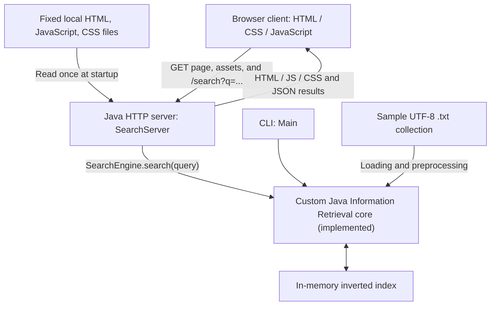

# IIT Search Engine

**SPL-1 Project**

Institute of Information Technology, University of Dhaka

**Student:** Rifat Al Maruf (BSSE1705)

## Overview

IIT Search Engine is a Java-based, domain-specific document search engine using
classical Information Retrieval (IR). Its academic objective is to implement
and understand preprocessing, indexing, matching, ranking, and result retrieval
over public or supervisor-authorized IIT documents.

The current application searches six fictional demonstration text files through
a responsive browser page, a Java HTTP JSON API, or a separate CLI. The browser
client uses plain HTML, JavaScript, and CSS to show ranked results without
navigating away. Java performs indexing, query validation, retrieval, and ranking.
The frontend implementation checkpoint on `feat/browser-client` is
`8b0a38906495fa850244a8e66e36bd5ea2c4e4eb`.

## Current architecture

The Java HTTP server calls the custom IR core and reuses an in-memory inverted
index built from the sample collection. It also serves three fixed web assets.
The browser sends URL-encoded GET queries and renders the returned JSON array.



`Main` and `SearchServer` are separate entry points using the same core classes.
Each process creates its own engine and index. The CLI supports manual rebuilds;
the HTTP server builds once before listening and reuses that index for searches.
It serves the page, fixed assets, health, and search on `127.0.0.1:8080`.
The web files are loaded once at startup, so edits require restarting the server.
The browser presents results; Java retains all search algorithms. Cross-computer
access remains future work.

## Current implementation

- UTF-8 loading of immediate `.txt` files, sorted by filename.
- Case normalization, ASCII letter/digit tokenization, punctuation separation,
  and filtering of 12 configured stop words.
- An inverted index mapping each term to document IDs and raw occurrence counts.
- Exact normalized keyword lookup and multi-word retrieval with ranked OR
  semantics; repeated query terms are counted once.
- TF-IDF-style ranking using
  `idf = ln((N + 1) / (df + 1)) + 1`, multiplied by raw term frequency and summed
  over distinct query terms. There is no document-length normalization.
- Descending score ordering with filename order for ties; all matches returned.
- A CLI menu for full index rebuild, search, statistics, and exit. A failed
  rebuild preserves the previously built index.
- A JDK HTTP server at `127.0.0.1:8080`: exact `GET /health` returns HTTP 200,
  `Content-Type: text/plain; charset=utf-8`, and the two-byte body `OK`.
- Exact `GET /search?q=...` calls the existing engine and returns JSON containing
  the decoded query, ordered results, filenames, and numeric scores.
- Query parsing requires one nonblank `q`, splits parameters before decoding,
  handles percent escapes and `+` as space, and rejects duplicate `q`, malformed
  escapes, invalid UTF-8, and parameters without `name=value` syntax.
- Application-handled query validation errors return HTTP 400 with a JSON
  `error` field. JSON strings escape quotes, backslashes, and low controls.
- Unsupported methods on any known path return 405 with `Allow: GET`;
  unknown paths return 404. Path validation precedes method validation.
- Seven dependency-free automated baseline regression tests for the IR core.
- An accessible native GET search form with a labeled required input. Without
  JavaScript, it can still navigate to the API's raw JSON response.
- Plain JavaScript submit handling with URLSearchParams, fetch, safe textContent
  rendering, loading feedback, and empty/error messages. Repeated completed
  searches replace earlier results; scores are rounded to two decimals for display.
- Local responsive CSS with system fonts, blue/neutral colors, visible keyboard
  focus, disabled-button styling, wrapping results, and stacked narrow-screen controls.

Previously verified sample-corpus statistics are **6 documents, 75 unique terms,
and 120 processed tokens**. Searching `java` ranks `java_programming.txt` before
`academic_notice.txt`. The CLI displays scores as 5.54 and 1.85; the JSON API
returns numeric values without that two-decimal display formatting.

Boolean operators are not parsed: `and` and `or` are currently stop words.
Quoted text is treated as ordinary keywords rather than a phrase query.

## JSON Search API

### Successful search

Request: `GET /search?q=java`

Status: **200**. Content-Type: `application/json; charset=utf-8`.
The following previously verified response is shown with indentation for
readability; the server emits compact JSON:

```json
{
  "query": "java",
  "results": [
    {
      "filename": "java_programming.txt",
      "score": 5.541893581161611
    },
    {
      "filename": "academic_notice.txt",
      "score": 1.8472978603872037
    }
  ]
}
```

`query` echoes the accepted decoded text. Results retain the engine's ranking
order, and `score` is a JSON number. There is no separate rank field.

### No results

Request: `GET /search?q=zzzznomatchingterm`

Status: **200**, with the same JSON Content-Type. A valid query with no matching
documents returns an empty array:

```json
{"query":"zzzznomatchingterm","results":[]}
```

### Invalid query

Request: `GET /search` (missing query component)

Status: **400**, with the same JSON Content-Type:

```json
{"error":"Bad request: Missing q parameter."}
```

The prefix is exactly `Bad request: `. Blank values, duplicate `q` parameters,
and invalid encodings also produce handled validation errors with a specific
reason. Other well-formed parameters are decoded and ignored; `q` is
case-sensitive. The API reads URL parameters and does not parse JSON request
bodies. A malformed request URI can be rejected by the HTTP stack before the
application's JSON error handler runs.

### Health and routing behavior

| Request | Status and response |
| --- | --- |
| `GET /` | 200; `text/html; charset=utf-8`; browser search page |
| `GET /app.js` | 200; `text/javascript; charset=utf-8`; fixed client script |
| `GET /styles.css` | 200; `text/css; charset=utf-8`; fixed stylesheet |
| `GET /health` | 200; `text/plain; charset=utf-8`; exact body `OK`, without newline |
| Valid `GET /search?q=...` | 200; JSON `query` and `results` |
| Invalid query on GET search | 400; JSON `error` for application-handled validation |
| Unsupported method on any of the five known paths | 405; `Allow: GET`; empty body |
| Unknown or suffixed path, such as `/search/` | 404; empty body |

404 and 405 responses are not JSON bodies. Unknown paths receive 404 even
with an unsupported method. `/health` does not run a search or perform a new
index diagnostic for each request.

Only the exact listed paths are exposed. Asset routes read trusted fixed files
at startup; there is no generic file server or route for downloading result
documents. Filenames in the results are plain text, not links or previews.

## Project roadmap

Completed milestones:

| Milestone | Completed implementation |
| --- | --- |
| Phase 1 | CLI, custom IR pipeline, and seven baseline regression tests |
| Phase 2.1 | HTTP health endpoint and routing checks |
| Phase 2.2A | SearchEngine initialization and indexing at server startup |
| Phase 2.2B | Validated plain-text HTTP search endpoint |
| Task 2.3 | JSON search results and validation errors, replacing plain-text search responses |
| Phase 2.4A | Native HTML GET form and exact root page route (`44d869b`) |
| Phase 2.4B | JavaScript search and in-page result rendering (`665509f`) |
| Phase 2.4C | Responsive CSS and fixed stylesheet route (`8b0a389`) |

Future work:

1. Broader browser, zoom/reflow, and accessibility testing and further usability improvements.
2. Network configuration and a verified cross-computer demonstration.
3. Positional indexing, explicit Boolean AND/OR queries, and phrase retrieval.
4. Partial/substring matching, basic fuzzy retrieval, Top-K results, and snippets.
5. Index persistence, further search improvements, and performance evaluation
   against a sequential-scan baseline.
6. Authorized IIT PDF import and text extraction, with OCR scope to be agreed
   with the supervisor.

These are planned capabilities. PDF extraction, fuzzy matching, positional
postings, snippets, persistence, and performance benchmarks are not implemented.

## Technology and academic scope

- Java; verified with Eclipse Temurin **JDK 25.0.3**.
- Built-in Java `HttpServer` from `jdk.httpserver`.
- Plain browser HTML, CSS, and JavaScript; no frontend framework, bundler, npm,
  external font download, or CDN is required.
- IntelliJ IDEA, Git, and GitHub.

Core IR algorithms and data structures are implemented manually to make their
behavior explainable and evaluable for SPL-1. No Lucene, Elasticsearch, Solr,
or other ready-made search-engine core is used. There are no external Java
dependencies, Maven/Gradle configuration, or JUnit dependency in the current
prototype.

## Repository structure

```text
src/
  Document.java          Document ID and filename
  TextProcessor.java     Token normalization and stop-word filtering
  InvertedIndex.java     Term-to-document frequency postings
  SearchEngine.java      Loading, indexing, retrieval, and ranking
  SearchResult.java      Document and score
  Main.java              Original CLI entry point
  SearchServer.java      Browser assets, HTTP health, and JSON search entry point
tests/
  BaselineTests.java     Seven automated regression tests
data/                    Six fictional demonstration text documents
web/
  index.html            Semantic search form and result containers
  app.js                GET API requests and safe DOM result rendering
  styles.css            Responsive layout and interaction styling
documents/               Original proposal form and presentation
learnings/               Learning journal and viva preparation
  README.md             Learning index and reading sequence
  01-phase1-foundations.md
  02-01-http-health-endpoint.md
  02-02-http-search-api.md
  02-03-json-search-api.md
  02-04-html-browser-client.md
  02-05-javascript-search-client.md
  02-06-responsive-css.md
out/                     Ignored generated classes and local verification output
iit-search-engine-prototype-v0.1.zip   Archived prototype
README.md
```

The Phase 2.2 and JSON manuals were included in documentation commit `e77dfd7`.
The frontend manuals describe the subsequent HTML, JavaScript, and CSS milestones.
Earlier manuals keep their historical checkpoints and verification context.

## Build, run, and test

Use PowerShell from the repository root. The commands below use one explicit
JDK for compilation and execution, avoiding the previously observed Java 8
launcher on `PATH`. Change the JDK path if your installation differs. This
project's verified toolchain is JDK 25; no dependency installation is needed.

```powershell
Set-Location 'D:\iit_drive\IIT\spl1\iit-search-engine'
$projectJdk = 'C:\Program Files\Eclipse Adoptium\jdk-25.0.3.9-hotspot'
& "$projectJdk\bin\javac.exe" -version
& "$projectJdk\bin\java.exe" -version
& "$projectJdk\bin\javac.exe" -encoding UTF-8 -d out\app src\*.java tests\BaselineTests.java
```

Compile successfully before running the following commands. Classes are written
only to ignored `out/app`; the existing source and sample documents are unchanged.

### CLI

```powershell
& "$projectJdk\bin\java.exe" -cp out\app Main
```

The CLI builds from relative folder `data`, so keep the repository root as the
working directory. Choose `3` for statistics, `2` then `java` for a sample search,
and `4` to exit.

### Regression tests

```powershell
& "$projectJdk\bin\java.exe" -cp out\app BaselineTests
```

The runner reports seven individual results and totals. Expected baseline:
`Total passed: 7`, `Total failed: 0`, exit code 0. Checks use explicit
`AssertionError`s, so `-ea` is unnecessary. Temporary fixtures are separate from
`data` and cleaned up by the harness.

### HTTP server

When port 8080 is available, start the server in its own console:

```powershell
& "$projectJdk\bin\java.exe" -cp out\app SearchServer
```

Keep the repository root as the working directory: `data` and all three
`web` files use relative paths. The server first prints `Indexed 6 documents.`
for the bundled collection, then `Listening on http://127.0.0.1:8080` after
successful startup. An index or web-file loading failure prevents startup.

Open **http://127.0.0.1:8080/** in Microsoft Edge or another suitable browser.
Enter `java` and submit. With JavaScript enabled, ranked filenames and scores
appear beneath the form without navigation. An unknown term gives an empty
result message; whitespace receives the server's nonblank-query error. Empty
input is blocked by native required validation in the tested browser.

Do not open `web/index.html` directly with a file URL. The page needs the Java
HTTP origin for its root-relative assets and search requests. Without working
JavaScript, the native form can still navigate to raw JSON. Changing a web file
requires a server restart because the fixed files are cached at startup.

From a second PowerShell console, use Windows `curl.exe` to inspect individual
responses independently of the page:

```powershell
curl.exe --noproxy '*' -i 'http://127.0.0.1:8080/health'
curl.exe --noproxy '*' -i 'http://127.0.0.1:8080/search?q=java'
curl.exe --noproxy '*' -i 'http://127.0.0.1:8080/search?q=java%20programming'
curl.exe --noproxy '*' -i 'http://127.0.0.1:8080/search?q=zzzznomatchingterm'
curl.exe --noproxy '*' -i 'http://127.0.0.1:8080/search'
curl.exe --noproxy '*' -i -X POST 'http://127.0.0.1:8080/search?q=java'
curl.exe --noproxy '*' -i 'http://127.0.0.1:8080/unknown'
```

These demonstrate health, ranked search, an encoded multi-word query, no
matches, missing-query validation, method rejection, and unknown-path handling.
Expected statuses are 200, 200, 200, 200, 400, 405, and 404 respectively.

Use Ctrl+C in the server's own console to stop the instance you launched.
If it remains running, verify that process's PID, executable, and command line
before stopping only the confirmed owned process. If startup reports
`Address already in use`, do not terminate an unidentified process to free
the port.

## Testing and verification record

The committed [baseline harness](tests/BaselineTests.java) contains seven IR
tests: text preprocessing, inverted-index correctness, keyword retrieval,
ranking, empty/unknown queries, rebuild correctness, and failed-rebuild
preservation. It does not start an HTTP server or test JSON serialization.

Prior Phase 1 verification recorded JDK 25.0.3 compilation, a successful CLI
smoke test, and seven passing tests. Task 2.3 verification again recorded
successful compilation and **7 passed, 0 failed**. These are previously executed
results, not fresh runtime checks for this documentation update.

Separate Codex-run HTTP integration checks used an external PowerShell/.NET
HTTP client script. That script is not a committed HTTP test suite. Its
reported Task 2.3 results included:

- Ranked `java` JSON output with the expected filenames, order, and numeric
  scores; scores compared with the implemented formula within `1e-12`.
- Empty arrays for unknown and stop-word-only queries.
- JSON 400 responses for eight query-validation inputs, including missing,
  empty, whitespace-only, duplicate, and invalid UTF-8 cases.
- Round-trip preservation of a combined query containing quotes, backslashes,
  all 32 U+0000-U+001F controls, Bengali, an emoji, and encoded separators;
  no literal low controls in the JSON body.
- Exact health body and media type, 404 for unknown/suffixed paths, and 405
  with `Allow: GET` for POST, PUT, and HEAD on both known endpoints.
- Cleanup of only the server processes launched for verification.

No aggregate HTTP test count is claimed. Detailed results and verification
limits are documented in the [JSON API manual](learnings/02-03-json-search-api.md).
The older occupied-port retry in the health manual was a separate failed launch;
it does not replace the later successful search API verification.

Frontend verification records distinguish Codex-run checks from user-confirmed
Microsoft Edge interaction:

| Milestone | Previously reported automated/static checks | User-confirmed Edge checks |
| --- | --- | --- |
| 2.4A: HTML (`44d869b`) | JDK 25.0.3 compilation; seven IR tests; root HTML and existing HTTP behavior | Page loaded; java navigated to ranked JSON; empty input blocked; whitespace produced backend validation |
| 2.4B: JavaScript (`665509f`) | Compilation; seven IR tests; script/API HTTP checks; JS syntax; mocked DOM/fetch checks | Four checks: java results without navigation; no-match message; whitespace error; repeated searches replaced results |
| 2.4C: CSS (`8b0a389`) | Compilation; seven IR tests; CSS/script/API HTTP checks; structural CSS, contrast, and static narrow-layout checks | Five checks: desktop appearance; in-page search; validation; 375px/320px responsive layout; keyboard Tab and focus visibility |

Node checks used a minimal DOM stub and mocked fetch, not a real browser.
CSS checks were structural and arithmetic, not a complete CSS validator or
automated screenshot suite. The Edge results were explicitly confirmed by
the user. These integration scripts were not committed as new test files;
there is no automated end-to-end browser test suite in this repository.

The curl commands above are instructions for reproducing checks. This
documentation task checks source consistency, excerpts, links, and Git state;
it does not rerun compilation, runtime tests, HTTP servers, or Edge interaction.
Cross-computer connectivity, performance, comprehensive accessibility, and
browser/viewport combinations beyond the reported cases remain unverified.

## Learning documentation

The [learning journal](learnings/README.md) links seven manuals in recommended
reading order: IR foundations, HTTP health, HTTP search integration, JSON,
[HTML architecture](learnings/02-04-html-browser-client.md),
[JavaScript integration](learnings/02-05-javascript-search-client.md), and
[responsive CSS](learnings/02-06-responsive-css.md).
They include implementation explanations, worked examples,
verification evidence and limits, viva preparation, and self-practice prompts.
Earlier manuals retain their historical milestone context.

## Current limitations

The bundled sample data is **fictional demonstration content, not official IIT
documentation**. The current demonstrations use the six bundled `.txt` files;
loading is limited to immediate text files in the selected folder. The index
is in memory, and document IDs depend on sorted filenames.

- UTF-8 transport and file reading do not provide general Unicode word search;
  tokenization retains ASCII letters and digits.
- The server is loopback-only on fixed port 8080. It serves three known web
  assets and the API, with no TLS, authentication, or general file hosting.
- No PDF import, OCR, fuzzy/substring matching, snippets, positional index,
  phrase search, or Boolean query parser is implemented.
- There is no index persistence, HTTP rebuild endpoint, automatic file refresh,
  pagination, or Top-K limit. The HTTP index is built once at startup.
- The API parses URL parameters rather than JSON request bodies. Its manual
  serializer does not explicitly guard non-finite scores or validate malformed
  Java UTF-16 strings; see the [JSON manual](learnings/02-03-json-search-api.md).
- The client trusts the current JSON success schema, has no application timeout
  or request cancellation, and allows one in-flight search through its handler.
  A pending query is not replaced merely by editing the input. Its generic
  failure message also covers JSON parsing or rendering errors.
- Filenames and scores are text only: no snippets, previews, clickable result
  documents, or download links are provided.

Broader retrieval quality, scalability, and network behavior remain to be
evaluated. The roadmap lists future capabilities rather than completed
achievements.
