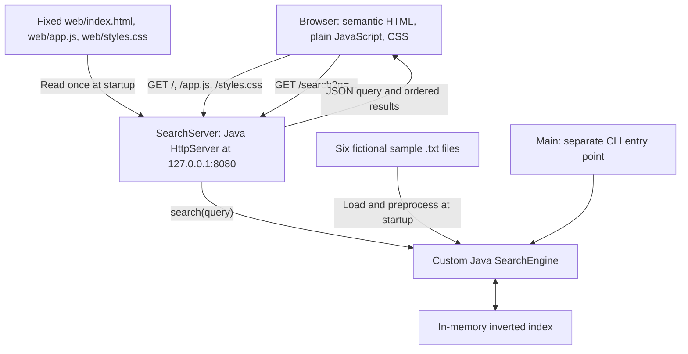

# Phase 2.4A: HTML browser client and application architecture

**Student:** Rifat Al Maruf (BSSE1705)

**Course:** SPL-1, Institute of Information Technology, University of Dhaka

**Record date:** October 28, 2026

**Project:** IIT Search Engine (`RIFAT-x7/iit-search-engine`)

## 1. Objective and historical checkpoints

Phase 2.4A introduced the first browser entry point for the existing Java JSON
search API. Its deliberate first step was a native HTML form: a browser could
submit keywords without JavaScript and display the API response. Later phases
added results inside the page and visual styling.

| Phase | Implementation commit | Responsibility introduced |
| --- | --- | --- |
| 2.4A | `44d869bc1a98701b8f7546cf33e380ae89aaca96` | HTML form, fixed HTML loading, and exact GET root route |
| 2.4B | `665509f724a3b68883bc6e504f4b2bf54bb5dee5` | JavaScript fetch and DOM rendering; script route |
| 2.4C | `8b0a38906495fa850244a8e66e36bd5ea2c4e4eb` | Responsive CSS, stylesheet route, and control wrapper |

This manual was prepared at the Phase 2.4C checkpoint on `feat/browser-client`.
Historical excerpts are identified explicitly. Current excerpts refer to that
committed checkpoint. The Java IR core was already implemented; these phases
added browser interaction without replacing its algorithms.

Read the [HTTP search manual](02-02-http-search-api.md) and
[JSON manual](02-03-json-search-api.md) for the earlier server contract.
Earlier manuals retain their own dates and statements about work that was
still planned at those stages.

## 2. Current architecture and responsibilities



| Component | Actual responsibility |
| --- | --- |
| HTML | Form, labels, headings, results structure, and resource references |
| JavaScript | Submit handling, HTTP request, status feedback, and result presentation |
| CSS | Layout, spacing, colors, responsive controls, and visible interaction states |
| SearchServer | Exact routing, fixed asset delivery, query validation, and JSON serialization |
| SearchEngine | Document loading, indexing, query processing, scoring, and sorting |

The browser does not receive the inverted index. It sends a query and receives
selected result fields. The CLI and HTTP server reuse the same Java classes
but create separate engine instances when run as separate processes. They do
not share one live index across processes.

## 3. Reading the current HTML document

The complete committed [web/index.html](../web/index.html) is short enough to
study as one document:

```html
<!DOCTYPE html>
<html lang="en">
<head>
    <meta charset="utf-8">
    <meta name="viewport" content="width=device-width, initial-scale=1">
    <title>IIT Search Engine</title>
    <link rel="stylesheet" href="/styles.css">
    <script src="/app.js" defer></script>
</head>
<body>
    <main>
        <h1>IIT Search Engine</h1>
        <form id="search-form" action="/search" method="get" accept-charset="UTF-8">
            <label for="query">Search keywords</label>
            <div class="search-controls">
                <input type="search" id="query" name="q" required>
                <button type="submit">Search</button>
            </div>
        </form>
        <section aria-labelledby="results-heading">
            <h2 id="results-heading">Search results</h2>
            <p id="search-status" role="status"></p>
            <ol id="result-list" aria-busy="false"></ol>
        </section>
    </main>
</body>
</html>
```

HTML is a markup language describing document structure. An element usually
has an opening tag, content, and a closing tag. Attributes inside an opening
tag configure it. For example, `lang="en"` is an attribute of `html`.
`meta`, `link`, and `input` are void elements and do not use closing tags.

### 3.1 Document declaration and language

`<!DOCTYPE html>` asks the browser to use standards mode. It is a declaration,
not a visible heading. Omitting it can activate historical rendering behavior.
`html` encloses the document. `lang="en"` describes the page's language and
helps tools such as speech output select appropriate language behavior.

### 3.2 Head, encoding, viewport, and title

`head` holds metadata and resource references. It is distinct from a visible
page header. `meta charset="utf-8"` identifies the document encoding; the
server also sends an appropriate UTF-8 Content-Type header.

The viewport metadata tells mobile browsers to use the device's viewport
width and an initial scale of 1. Without it, a narrow device can render a
desktop-sized layout and shrink the page. It does not itself create responsive
rules: the CSS media query supplies those rules.

`title` supplies the browser tab title. The visible `h1` is a separate element.
Using both gives the document a useful name in browser navigation and a clear
heading within its content.

### 3.3 Body, main, and heading hierarchy

`body` contains the rendered document content. `main` identifies its principal
content landmark. `h1` names the application, while `h2` introduces results.
Headings express document hierarchy; CSS independently determines their size.
Choosing a heading merely to obtain large text would confuse structure with
presentation.

## 4. The form and its native GET contract

### 4.1 Form attributes

The current form retains `action="/search"`, `method="get"`, and
`accept-charset="UTF-8"`. The leading slash in `/search` refers to the root of
the current origin, so it targets this Java server rather than a local file.
GET submits form data in the URL query string. It is appropriate here because
search retrieves information and does not intentionally alter the collection.

For a normal query, native submission can navigate to
`http://127.0.0.1:8080/search?q=java`. Browser serialization can encode spaces
as plus signs; the server accepts that convention as well as percent escapes.
URL encoding and JSON escaping have different jobs and must not be confused.

### 4.2 Label, input, button, and required

`label for="query"` associates the text with the input whose `id` is `query`.
This gives the control an accessible name, and activating the label focuses
the input. A placeholder would not replace this persistent label.

`type="search"` provides a native text field intended for search. Browser
appearance may vary. `required` is a Boolean attribute: its presence enables
empty-value validation. Writing `required="false"` would still leave the
attribute present; removing it is how that requirement would be disabled.

`button type="submit"` explicitly submits its containing form. Keyboard users
can reach it with Tab, and a typical Enter submission in the input follows
the same form behavior. Native constraint validation normally happens before
the form's submit listener runs.

Required text is not equivalent to a useful search query. Spaces are text,
so whitespace-only input can reach the server. The Java parser checks
`isBlank()` and returns its nonblank-query error. Client validation improves
interaction; server validation remains authoritative.

### 4.3 Why name="q" matters

`name="q"` determines the submitted parameter key. `id="query"` identifies the
element inside the document. Those strings have different purposes and need
not be identical. Removing `name` would break native form submission even
though JavaScript could still find the input by ID.

The backend calls `parseQuery` on the raw URI query, requires exactly one
nonblank decoded `q`, and then calls `engine.search(query)`. It rejects
duplicate `q` parameters and invalid encodings rather than trusting the browser.
The input is not automatically a phrase query or Boolean expression.

## 5. Native behavior and progressive enhancement

This is the exact historical form at the Phase 2.4A commit:

```html
        <form action="/search" method="get" accept-charset="UTF-8">
            <label for="query">Search keywords</label>
            <input type="search" id="query" name="q" required>
            <button type="submit">Search</button>
        </form>
```

It had no script or results section. Submitting `java` navigated away from the
HTML page to the JSON endpoint. That was intentional verification of browser
submission, not a result-rendering defect.

Phase 2.4B added a submit listener that calls `preventDefault`, fetches JSON,
and renders results beneath the form. The native attributes remain as a
fallback when JavaScript is unavailable or has not attached its handler.
Without working JavaScript, successful native submission still navigates to
raw JSON. This is a basic fallback, not a second server-rendered results page.

Once the JavaScript handler has intercepted submission, a later network error
does not automatically activate native navigation; the handler displays an
error message instead. See the [JavaScript manual](02-05-javascript-search-client.md).

## 6. IDs, classes, results, and accessibility

IDs such as `search-form`, `query`, `search-status`, and `result-list` are
document hooks. `getElementById` uses them directly. `results-heading` also
connects a heading to its section's accessible name. IDs should be unique.

The class `search-controls` belongs to a nonsemantic `div` wrapper. It groups
the input and button for flexbox styling without changing their form ownership.
The script's descendant button selector still finds the button inside it.
Classes are reusable styling hooks; they do not define submitted parameters.

`section` groups results around a heading. `p` holds status prose. `ol`
represents an ordered list, suitable because result position expresses rank.
JavaScript appends `li` elements containing filename and score text. They are
not anchors, document previews, or download controls.

`aria-labelledby="results-heading"` uses an element ID to name the section.
`role="status"` provides polite live-status semantics, intended for updates
without moving keyboard focus. `aria-busy` indicates that the result list is
being updated; JavaScript changes it between `true` and `false`. These
attributes supplement semantic HTML; they do not fetch data or style controls.
The status element sits outside the busy list so loading text is not inside
that busy subtree. See the [WAI-ARIA status definition](https://www.w3.org/TR/wai-aria-1.2/#status).

The user's keyboard test verified Tab navigation and visible focus in Edge
during Phase 2.4C. No screen-reader test or complete accessibility audit was
reported. An accessibility attribute is implementation evidence, not proof
that every assistive-technology combination was tested.

## 7. Loading JavaScript and CSS

`<link rel="stylesheet" href="/styles.css">` asks the browser to retrieve the
external stylesheet. Separating structure and presentation keeps HTML readable.
The file uses system fonts and contains no external downloads.

`<script src="/app.js" defer></script>` loads an external classic script.
`defer` allows fetching while HTML parsing continues and delays execution until
parsing finishes. This is why the script can select form and results elements
even though the script reference appears above them in `head`.
It does not mean that every later network request waits for the script.
See the [HTML script definition](https://html.spec.whatwg.org/multipage/scripting.html#attr-script-defer).

The browser makes separate asset requests. Opening the HTML as a `file:` URL
is not the intended deployment: root-relative asset and API URLs must be served
through the Java HTTP origin. Open `http://127.0.0.1:8080/` instead.

## 8. Java startup loading and exact HTTP routes

Current startup excerpt from [SearchServer.java](../src/SearchServer.java):

```java
String indexHtml = Files.readString(Path.of("web", "index.html"), StandardCharsets.UTF_8);
String appJs = Files.readString(Path.of("web", "app.js"), StandardCharsets.UTF_8);
String stylesCss = Files.readString(Path.of("web", "styles.css"), StandardCharsets.UTF_8);
```

`Path.of` constructs a relative filesystem location from trusted constant
parts. It does not itself open a file. `Files.readString` reads the entire file
using the supplied charset, closes its file resource, and returns text.
The variables store that text for reuse by later handler invocations.

Run from the repository root: both `data` and `web` resolve relative to the
process working directory. These operations occur once before the server
starts. An `IOException`, including a missing file, can propagate from `main`
and prevent startup. Changing a web file later requires restarting to load it.

The server has a root context, then explicitly checks raw paths because context
matching alone uses prefixes. It does not transform a requested path into a
filesystem path. `/web/styles.css` and `/app.js/` are not alternate routes.

| Exact request | Status | Response Content-Type and content |
| --- | --- | --- |
| GET `/` | 200 | `text/html; charset=utf-8`; cached HTML text |
| GET `/app.js` | 200 | `text/javascript; charset=utf-8`; cached JavaScript |
| GET `/styles.css` | 200 | `text/css; charset=utf-8`; cached stylesheet |
| GET `/health` | 200 | `text/plain; charset=utf-8`; exact `OK` |
| GET `/search?q=...` with valid query | 200 | `application/json; charset=utf-8`; ordered results |
| Application-handled search validation failure | 400 | JSON `error` beginning `Bad request: ` |
| Unsupported method on any known path | 405 | Empty body and `Allow: GET` |
| Unknown path | 404 | Empty body |

The handler checks paths before methods, so POST on an unknown path is 404.
It uses `sendResponse` to encode cached text as UTF-8 and compute response byte
length. Content-Type describes those bytes; the browser uses the media type
to interpret HTML, JavaScript, or CSS. This is fixed asset delivery, not a
generic file server or server-side HTML template engine.

## 9. Worked request and response walkthroughs

### 9.1 Current search for java

1. Browser GET `/` receives HTML; it separately requests the CSS and script.
2. After parsing, the deferred script attaches a listener.
3. The user enters `java`; native validation allows nonempty input.
4. The listener cancels navigation and sends GET `/search?q=java`.
5. Java validates the parameter and searches its existing in-memory index.
6. The JSON array lists `java_programming.txt` before `academic_notice.txt`.
7. JavaScript inserts two ordered list items, displaying scores 5.54 and 1.85.
8. CSS styles those ordinary elements. It neither queries nor sorts documents.

The full scores previously recorded were 5.541893581161611 and
1.8472978603872037. No clickable result document is created by this flow.

### 9.2 Empty input, whitespace, and no matches

An empty required field is blocked by native validation in the tested browser.
Whitespace passes that basic constraint but produces Java's HTTP 400 JSON error.
An unknown nonblank term is valid and produces HTTP 200 with an empty results
array. JavaScript displays `No results found.` for that successful empty search.
These outcomes distinguish input validity from whether a document matches.

## 10. Verification evidence and its boundaries

The following are prior results from this project session, not fresh runtime
checks performed while writing this manual.

| Evidence source | Phase 2.4A record |
| --- | --- |
| Codex-run Java checks | Temurin JDK 25.0.3 compilation; seven baseline tests passed |
| Codex-run HTTP checks | Exact root HTML, health, JSON ranking, validation, 404, and 405 checks passed |
| User-confirmed Microsoft Edge check | Page loaded successfully |
| User-confirmed Microsoft Edge check | Native `java` submission displayed ranked raw JSON |
| User-confirmed Microsoft Edge check | Empty input blocked by the browser |
| User-confirmed Microsoft Edge check | Whitespace received the backend nonblank-query error |

Codex's browser surface was unavailable during its Phase 2.4A work, so the
manual Edge evidence comes from the user's explicit confirmation. Subsequent
JavaScript and CSS behavior is recorded in the next two manuals. No automated
end-to-end browser test suite or new committed browser test files were added.

This documentation task performs source, excerpt, link, and Git validation.
No compiler, Java test runner, HTTP server, or Edge session is rerun here.
The seven committed tests concern IR behavior, not HTML layout.

## 11. Common mistakes and current limits

- Confusing `id` with `name` can leave a field selectable but absent from a
  native request. Their roles must be explained separately.
- Replacing the visible label with decoration would remove useful naming.
- Removing `defer` without moving or otherwise coordinating the script can
  make element lookups run before the elements exist.
- Serving arbitrary request paths from disk would introduce a broader and
  unnecessary file-access problem; this implementation serves three constants.
- Copying historical raw-JSON navigation into a description of the current
  JavaScript path would mix two milestones.

The application remains loopback-only, serves a six-file fictional corpus,
and builds its index once at startup. It has no PDF import, OCR, fuzzy search,
phrase/Boolean parser, snippets, result downloads, or dynamic document refresh.
Transport supports UTF-8, but retained search tokens are ASCII letters and
digits. Cross-computer access and comprehensive accessibility remain unverified.

## 12. Supervisor viva preparation

1. **Why add an HTML page when the JSON API already worked?** It gives users a
   browser entry point for entering a query instead of manually constructing URLs.
2. **What did Phase 2.4A implement?** A native HTML GET form and exact root route.
3. **What does DOCTYPE do?** It selects standards-mode HTML interpretation.
4. **How do head and body differ?** Head holds metadata and resources; body holds
   the document content presented to users.
5. **Why include both title and h1?** The tab needs a title, and the content needs
   its own primary heading.
6. **Why specify lang?** It describes the page language for browsers and assistive tools.
7. **What does the viewport declaration contribute?** It makes the mobile layout
   viewport follow device width so responsive rules can operate as intended.
8. **What does action="/search" mean?** Submit to the root-relative search path
   on the same origin.
9. **Why does the input need name="q"?** It supplies the query parameter key
   expected by the Java parser.
10. **How is the label associated?** Its for value matches the input's id.
11. **Does required reject whitespace?** Not for this text field; Java performs
    the authoritative nonblank validation.
12. **What happens without JavaScript?** The native form can navigate to raw JSON.
13. **Why use an ordered list?** Array position expresses rank, and list numbering
    communicates that order without new ranking logic.
14. **What is the class search-controls for?** Grouping two controls for CSS layout.
15. **Why use defer?** Run the external script after the document is parsed.
16. **What does role=status do?** Provides polite live-status semantics without
    requiring focus to move to each update.
17. **Why use fixed filesystem paths?** Only the known web assets are needed;
    untrusted request paths never choose files to read.
18. **Why run from the repository root?** Relative data and web paths resolve there.
19. **Does HTML implement TF-IDF?** No. SearchEngine computes scores and ordering.
20. **Are filenames links to downloadable files?** No. The current UI displays text only.

## 13. Self-practice and reflection

Trace a native query with a space, and identify where its encoded form becomes
ordinary text. Then trace the same query through JavaScript and compare which
document the browser keeps displayed. Explain each ID in the HTML without
looking at the JavaScript, then check your explanation against its selectors.

Sketch the architecture and mark which parts run inside the browser versus the
JVM. Predict what happens when a web file is missing at startup. Complete any
personal reflection only after doing the exercise; these notes do not invent
learning experiences or reflection answers.

Continue with [JavaScript search integration](02-05-javascript-search-client.md),
[responsive CSS](02-06-responsive-css.md), or the [learning index](README.md).
